# AWS Hybrid Cloud Site-to-Site VPN Lab (Terraform)

**Regions:** `us-east-1` (simulated on-premises) + `eu-north-1` (AWS cloud).

This deploys a **real AWS managed Site-to-Site VPN** between an AWS Virtual Private Gateway (VGW) and an EC2 **Libreswan customer gateway** in a second region. The first VPC stands in for a company data center; it is **not physical on-premises infrastructure**.

Inspired by the class exercise *AWS Setup Site to Site VPN Connection*, modified to use `us-east-1` and `eu-north-1` and a modern Amazon Linux 2023 / Libreswan VPN router. The original class handout used Mumbai and N. Virginia and OpenSWAN.

## Architecture

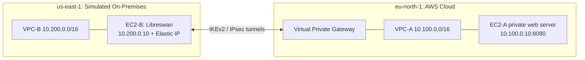

Application traffic between the two private CIDRs is protected by the **encrypted IPsec VPN tunnel**. The cloud EC2 instance has **no public IP and no NAT/Internet Gateway**. Terraform creates a small private HTTP service to prove end-to-end connectivity.

## Created resources

- 2 VPCs, 2 subnets, route tables and associations
- Internet Gateway for the simulated on-premises side only
- Amazon Linux 2023 EC2 VPN router (`us-east-1`) with Elastic IP, IAM + SSM
- Private Amazon Linux 2023 EC2 web server (`eu-north-1`)
- VGW, CGW, AWS-managed Site-to-Site VPN, static VPN route and VGW route propagation
- Security groups restricted to the two AWS VPN outside IPs and lab private CIDRs
- AWS-generated VPN tunnel PSKs stored in SSM Parameter Store SecureString (`us-east-1`)
- SSM association to configure **Tunnel 1** and prepare **Tunnel 2** as a manual backup on the router

## Requirements

- AWS account with permission to create VPC, EC2, EIP, IAM, VPN, SSM, and associated resources in both regions
- Terraform **>= 1.6**; AWS provider **6.x** (downloads during `terraform init`)
- AWS CLI v2 installed, working Windows PowerShell, and configured AWS credentials
- Enough EC2, Elastic IP, VPC and VPN service quotas
- A budget alert before applying

**WARNING — NOT FREE:** EC2, public IPv4 / EIP, VPN connection hours, cross-region data transfer, and other resources may be billed. VPN connection billing continues while it exists even if the EC2 router is stopped. Use `terraform destroy` after the exercise. Check https://aws.amazon.com/vpn/pricing/ and https://aws.amazon.com/ec2/pricing/ for your account and regions. Do not assume any free tier covers this lab.

**SECURITY — TERRAFORM STATE:** AWS-generated VPN pre-shared keys appear in provider-managed VPN attributes, and SecureString parameters can also persist values in Terraform state. Protect `terraform.tfstate`, use a secured encrypted remote backend for shared/production work, and NEVER commit `.tfstate`, `.tfvars`, or credentials to GitHub. No VPN PSKs are stored in this project's source files. The lab uses Amazon-managed SSM KMS encryption; production deployments need stricter access control, key rotation, audit and change management.

## Quick start — Windows PowerShell

```powershell
# 1. Extract the ZIP; open PowerShell in the extracted project folder
cd .\terraform-aws-hybrid-cloud-vpn

# 2. Confirm credentials and binaries
terraform version
aws --version
aws sts get-caller-identity

# 3. Optional: personalize defaults
Copy-Item .\terraform.tfvars.example .\terraform.tfvars
# Edit terraform.tfvars if needed (do not commit it).

# 4. Deploy
terraform init
terraform fmt -recursive
terraform validate
terraform plan -out lab.tfplan
terraform apply lab.tfplan

# 5. Show non-secret outputs
terraform output
```

It may take time for the EC2 router to finish installing Libreswan and for the SSM association to run. For manual tunnel failover, first stop Tunnel 1 and then initiate Tunnel 2 on the router: `sudo ipsec auto --down aws-tunnel1; sudo ipsec auto --up aws-tunnel2`. This does **not** implement production automatic failover. If `terraform apply` reports an SSM association error, inspect the SSM agent status and association output in `us-east-1`. This repository documents a verified lab run on **2026-11-21** (see the evidence screenshots below). Your own deployment still requires AWS permissions, quotas and testing.

## Verify the VPN

Option A — Execute the included PowerShell test:

```powershell
.\scripts\test-vpn.ps1
```

It uses **AWS Systems Manager Run Command** in `us-east-1` to execute `ipsec status`, `ipsec trafficstatus`, `ping -c 4 10.100.0.10`, and `curl http://10.100.0.10:8080`. The script also prints AWS VPN tunnel telemetry from `eu-north-1`.

Option B — Console:

1. `eu-north-1` → VPC → Site-to-Site VPN Connections → select VPN → **Tunnel details**; check tunnel statuses. One tunnel UP is enough to demonstrate the lab; Tunnel 2 is preconfigured as a manual standby, not automatic high availability.
2. `us-east-1` → Systems Manager → State Manager → find `hybridvpn-lab-configure-libreswan` (or your project prefix) → review execution status. Systems Manager → Fleet Manager → find the router.
3. Execute `sudo ipsec status`, `ping -c 4 10.100.0.10`, `curl -fsS http://10.100.0.10:8080` via Run Command/Session Manager.

Success means: at least one **UP** tunnel, responses to **ping**, and an HTML page showing **Hybrid Cloud VPN Lab - Connected!**.

### Verified lab results (21 November 2026)

| Test | Observed result |
| --- | --- |
| Terraform apply | **38 resources added**, 0 changed, 0 destroyed |
| US simulated on-prem network | `us-east-1` / `10.200.0.0/16` |
| EU private cloud network | `eu-north-1` / `10.100.0.0/16` |
| AWS VPN Tunnel 1 | **UP** |
| AWS VPN Tunnel 2 | **DOWN** — manually configured standby, not active high availability |
| SSM Run Command | **Success** |
| Libreswan | IKEv2 IKE SA and Child SA **established** |
| Private ping | **4/4 replies, 0% packet loss**, average RTT **112.155 ms** |
| Private HTTP | `http://10.100.0.10:8080` returned `Hybrid Cloud VPN Lab - Connected!` |

These are results from a lab using **an AWS-hosted simulated on-premises VPC**, not a physical on-premises data center. This verifies one active encrypted VPN tunnel and workload connectivity; it does not establish automatic failover or production readiness.

## Troubleshooting

```powershell
.\scripts\diagnose-vpn.ps1
```

On the router (via Systems Manager), useful Linux commands:

```bash
sudo systemctl status ipsec
sudo journalctl -u ipsec -n 100 --no-pager
sudo ipsec status
sudo ipsec trafficstatus
sudo ip xfrm state
sudo ip xfrm policy
sudo systemctl status amazon-ssm-agent
ping -c 4 10.100.0.10
curl --max-time 15 -v http://10.100.0.10:8080
```

Common causes: IKE mismatch (only IKEv2 AES256/SHA2-256/DH14 allowed here), EC2 router source/destination check, missing VGW propagated route, missing static VPN route, UDP 500/4500 blocked, SSM permissions / EIP not yet ready, wrong PSK, or private server cloud-init not complete.

For a VPN connection that is **Available** but tunnels **DOWN**, inspect SSM association first: a VPN connection being Available does not itself mean either tunnel is UP. Libreswan initiates Tunnel 1 using `auto=start`; Tunnel 2 is configured as a manual standby (`auto=add`). This specific lab run established Tunnel 1; a new deployment must be verified independently.

### Notes about routing

- Cloud-side route propagation automatically propagates `10.200.0.0/16` via the VGW into the private subnet route table after static VPN route creation.
- The Libreswan gateway itself originates lab test traffic on `10.200.0.10`; its kernel IPsec policy handles the cloud CIDR (`10.100.0.0/16`).
- If you later add other servers inside the simulated on-prem VPC, you must add a route to the cloud CIDR targeting the router ENI/instance and extend the lab firewall/forwarding rules. The ZIP currently tests connectivity **from the router EC2**, not from arbitrary on-prem subnet hosts.
- The router is behind an AWS Elastic-IP mapping; IKE NAT traversal (UDP 4500) may be used. Restrict peer inbound rules to AWS tunnel outside IPs.

## Evidence gallery — GitHub screenshots

The original screenshots were reviewed and curated. Personal AWS console account identity displayed in the browser header was excluded from the repository copies. The evidence below is from the user-provided lab capture (21 November 2026).

### Key outcome: private application reached through IPsec

**1. VPN tunnel status (Tunnel 1 UP, Tunnel 2 DOWN / standby)**

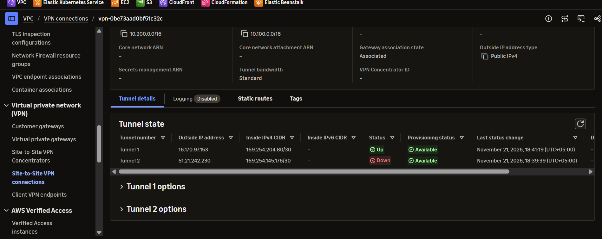

**2. Private-IP ping across regions (4/4 replies, 0% packet loss)**

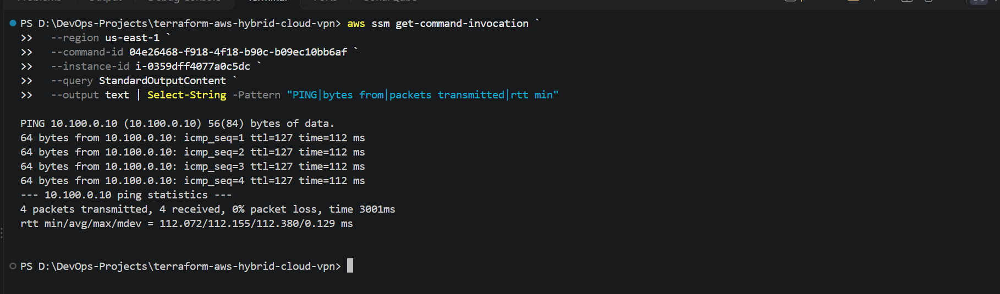

**3. Private HTTP application response through the VPN**

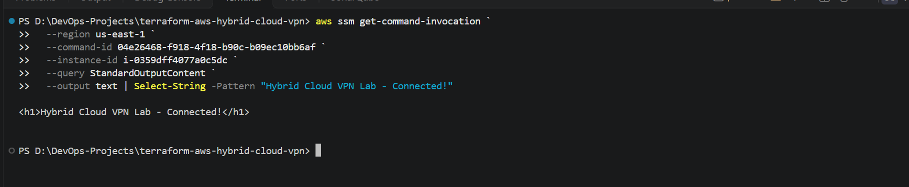

**4. Automation evidence: AWS Systems Manager Run Command succeeded**

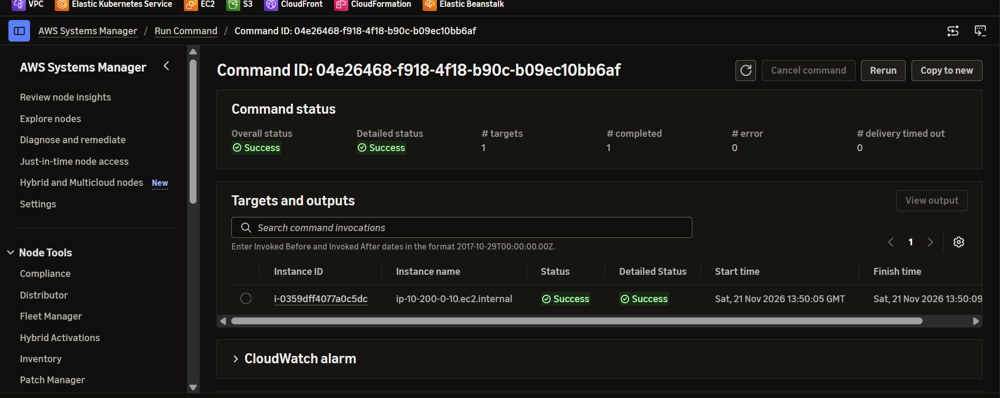

**5. IKEv2 and IPsec security associations established**

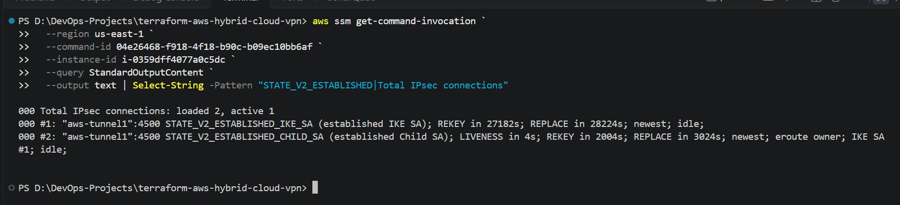

### Infrastructure provisioning and networking

| Evidence | Screenshot |
| --- | --- |
| Terraform outputs for both regions | 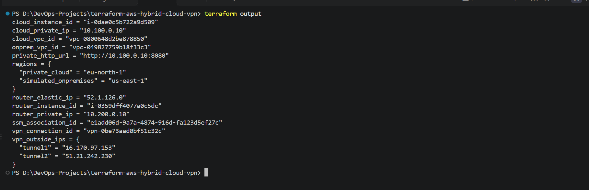 |
| Simulated on-prem VPC (`us-east-1`) | 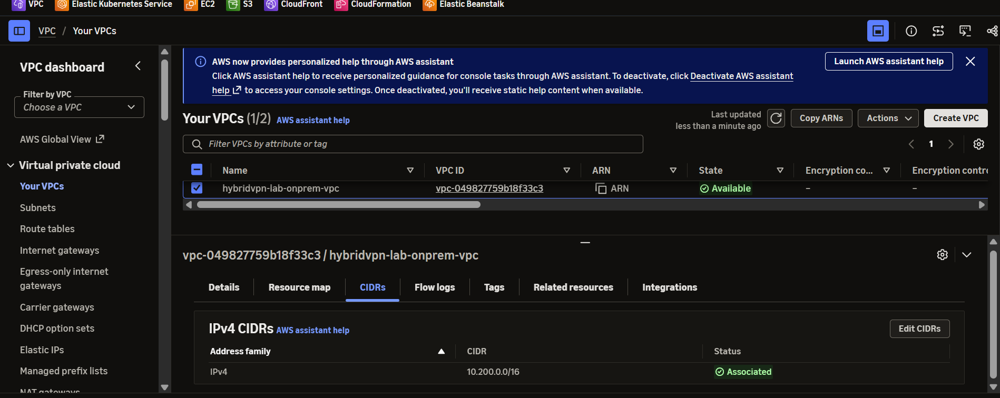 |
| Cloud VPC (`eu-north-1`) | 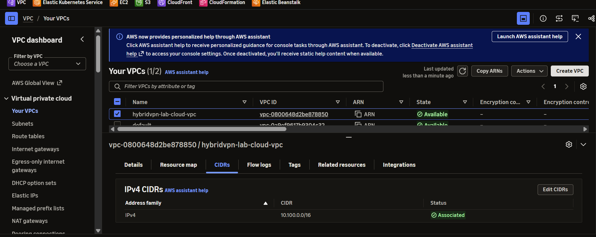 |
| EC2 Libreswan router | 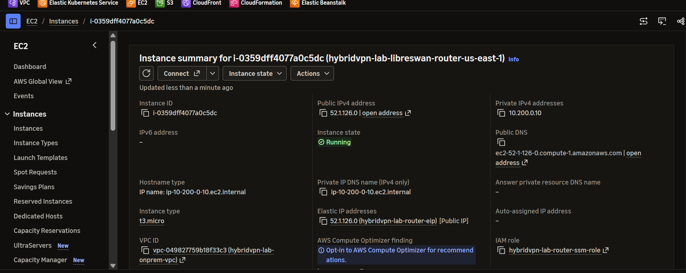 |
| EC2 private cloud web instance | 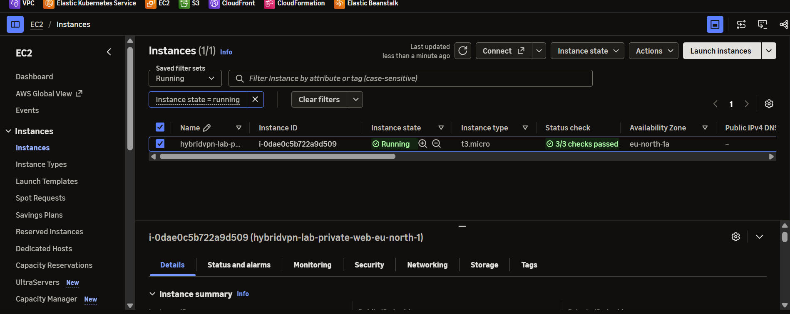 |
| AWS Virtual Private Gateway | 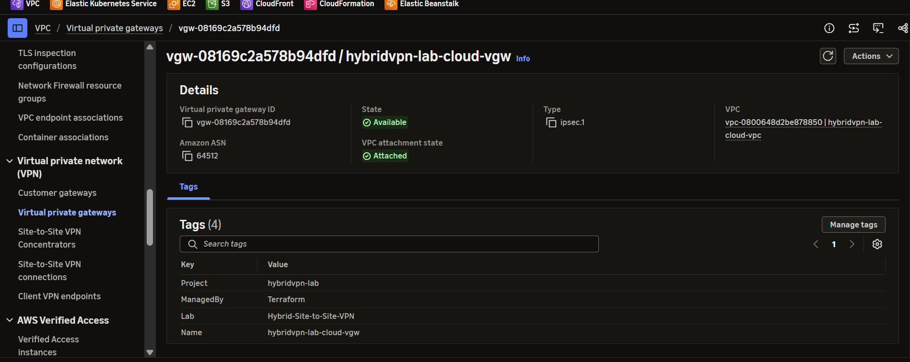 |
| AWS Customer Gateway | 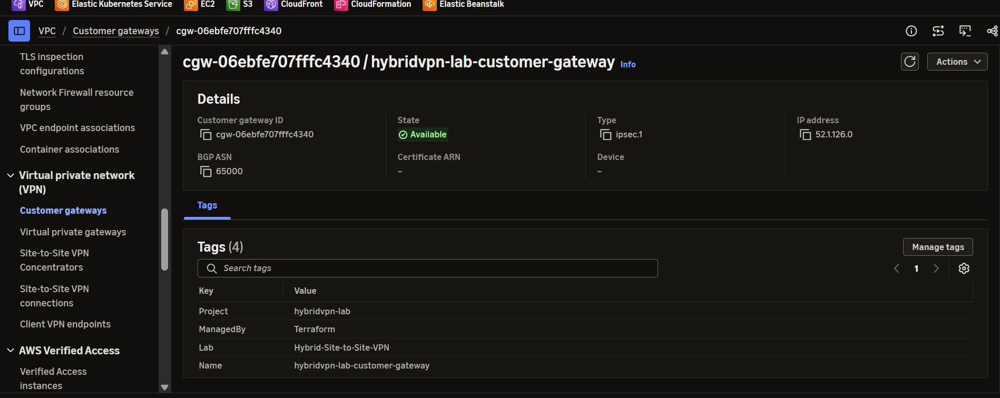 |
| Propagated cloud route to VGW | 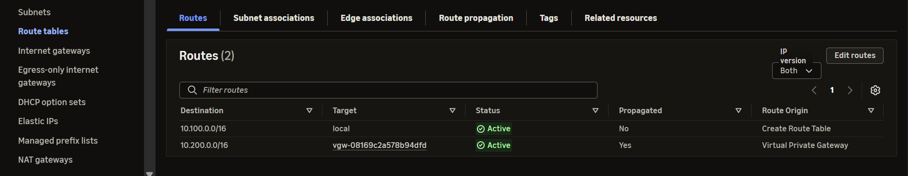 |

<details>
<summary><strong>Additional proof: AWS CLI tunnel telemetry</strong></summary>

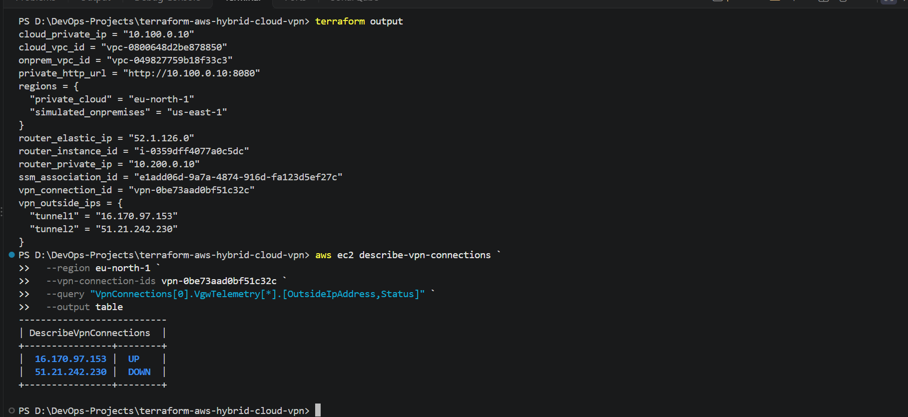

</details>

For LinkedIn, use four images in this order: `09-vpn-tunnel1-up.png`, `12-private-ip-ping-0-loss.png`, `13-private-http-success.png`, `01-terraform-outputs.png`.

## Cleanup — REQUIRED

From the **same project root with the same Terraform state**, run:

```powershell
terraform plan -destroy
terraform destroy
```

Confirm removal in **both** regions: VPN connection, VGW, CGW, SSM params/association, router and cloud EC2, Elastic IP, VPCs and networking. Do not delete Terraform state before destroy; otherwise you can orphan billable resources. Some eventual AWS cleanup (EIP, VPN tunnel) may take additional time.

## Helpful official documentation

- AWS Site-to-Site VPN: https://docs.aws.amazon.com/vpn/latest/s2svpn/SetUpVPNConnections.html
- Terraform VPN connection: https://registry.terraform.io/providers/hashicorp/aws/latest/docs/resources/vpn_connection
- Terraform SSM association: https://registry.terraform.io/providers/hashicorp/aws/latest/docs/resources/ssm_association
- Libreswan `ipsec.conf` man page: https://libreswan.org/man/ipsec.conf.5.html
